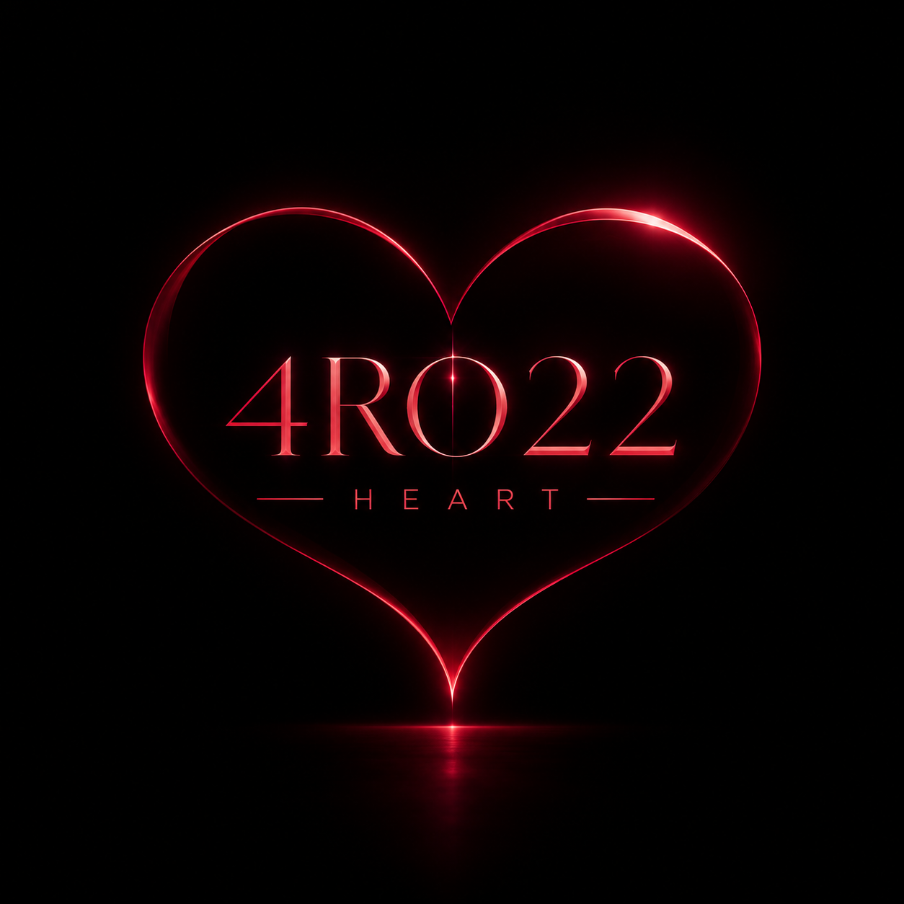
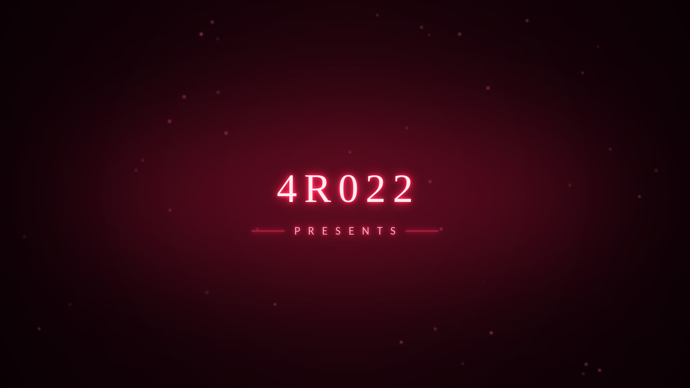
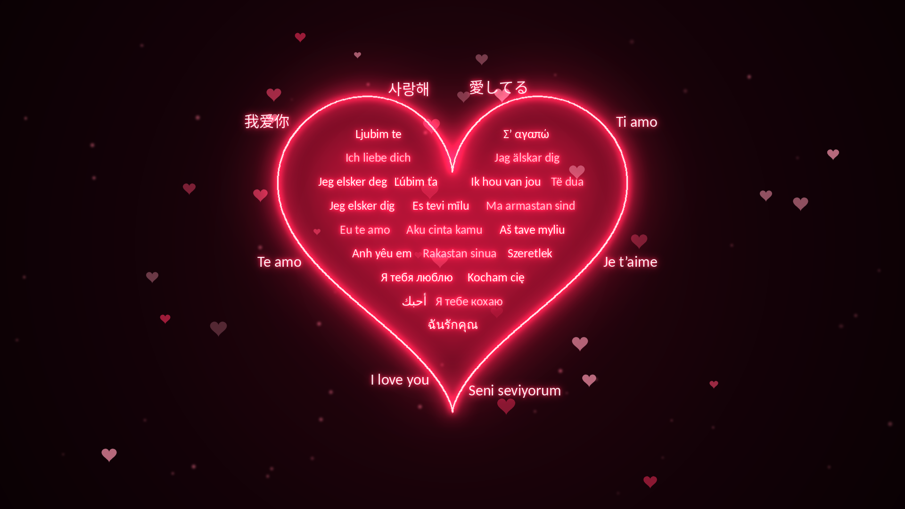
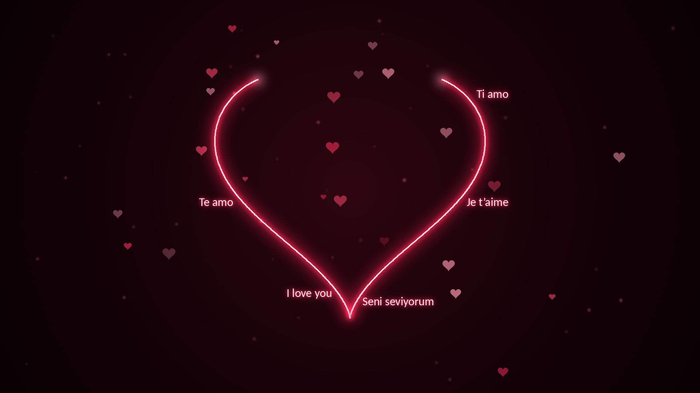
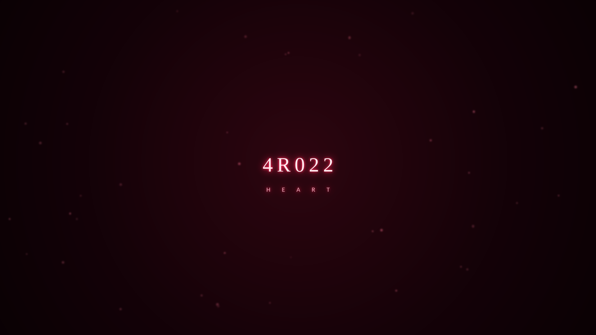

<div align="center">



# 4R022 HEART

### A cinematic *"I love you"* scene in **30 languages** — drawn in light, on **every monitor**.
### 30 dilde *"Seni seviyorum"* — ışıkla çizilen, **tüm monitörlerde** çalışan sinematik sahne.

<br>

[](../../releases)
[](../../actions)
[](../../releases)
[](../../stargazers)


**[🇹🇷 Türkçe](#tr)** &nbsp;•&nbsp; **[🇬🇧 English](#en)** &nbsp;•&nbsp; **[📝 Changelog](Docs/CHANGELOG.md)** &nbsp;•&nbsp; **[⬇️ Releases](../../releases)** &nbsp;•&nbsp; **[🐞 Issues](../../issues)**

</div>

---

<a id="tr"></a>

# 🇹🇷 Türkçe

## 📑 İçindekiler
[Nedir?](#-4r022-heart-nedir) · [Önizleme](#-önizleme) · [Özellikler](#-özellikler) · [Sahne akışı](#-sahne-akışı) · [Kurulum](#-kurulum) · [Ayarlar ve performans](#-ayarlar-ve-performans) · [Kendi EXE'nizi üretin](#-kendi-exenizi-üretin) · [Platform notları](#-platform-notları) · [SSS](#-sık-sorulan-sorular) · [Lisans ve marka](#-lisans-ve-marka-kuralı) · [Katkı](#-katkı)

## ❤️ 4R022 Heart nedir?

**4R022 Heart**, Python ve Qt (PySide6) ile yazılmış sinematik bir sahne uygulamasıdır. Önce **"4R022 PRESENTS"** harf harf belirir; ardından bir kalbin çevresi ışıkla çizilir, kalbin içi **30 dilde "Seni seviyorum"** yazılarıyla dolar, kalp atar ve parlar. Sahne yaklaşık **49 saniye** sürer; müzik kısılır, yazılar közlere dönüşerek silinir ve program kendiliğinden kapanır.

Doğum günü, yıldönümü, evlilik teklifi, sürpriz… ya da sevdiklerinize bir şey göstermek için tasarlandı. Bağlı **tüm monitörlerde aynı anda** tam ekran açılır.

## 🖼️ Önizleme

<table>
  <tr>
    <td align="center" width="50%"><br><b>① Açılış — 4R022 PRESENTS</b></td>
    <td align="center" width="50%"><br><b>② Kalp tamamen görünür — 30 dil</b></td>
  </tr>
  <tr>
    <td align="center"><br><b>③ Kalp ışıkla çiziliyor</b></td>
    <td align="center"><br><b>④ Kapanış kartı</b></td>
  </tr>
</table>

> 📌 Bu görseller projenin kendi yerleşim motoruyla üretilmiş **önizlemelerdir**. Kendi makinenizden gerçek kareleri almak için:
> `python Main/Main.py --screenshot Assets/Screenshots` — ya da GitHub'da **Actions → Update screenshots** iş akışını çalıştırın.

## ✨ Özellikler

| | |
|---|---|
| 🎬 **Sinematik akış** | harf harf açılış, ışık süpürmesi, kalp çizimi, "yazı yazan ışık", ateşleme, kalp atışı, köze dönüşen kapanış |
| 🌍 **30 dil** | her dil doğru yazı tipiyle (Çince, Japonca, Korece, Arapça — sağdan sola —, Tayca dahil) |
| 🖥️ **Çoklu monitör** | tüm ekranlarda aynı anda, tek ortak saatle; ekran sayısı/çözünürlük otomatik |
| 📐 **Kaymasız yazı** | tüm yazılar ortak taban çizgisinde; piksel hizalı; kalp atarken yazılar bulanıklaşmaz |
| 🎵 **Müzik** | kalp çizimiyle başlar, yumuşak geçişle döngüye girer, sona doğru kısılır |
| ⚡ **Hızlı başlangıç** | klasör (onedir) çıktısı: açılışta dosya çıkarma yok; varlıklar açılış sırasında arka planda hazırlanır |
| 🧠 **Akıllı performans** | otomatik kalite profili, kirli-dikdörtgen çizim, GC duraklaması yok, kare düşerse otomatik sadeleşme |
| 🔧 **Python gerektirmeyen build** | tek tıkla; kendi Python'unu ve araçlarını kendisi indirir |
| 🛡️ **Güvenli** | tamamen çevrimdışı, ağ bağlantısı yok, veri toplamaz |

## 🎞️ Sahne akışı

| Saniye | Olay |
|---|---|
| 0 – 6,3 | **4R022 PRESENTS** harf harf yazılır, ışık süpürür, **3 sn tam görünür**, zarifçe dağılır |
| 5,8 – 12,6 | Kalbin çevresi ışıkla çizilir · **müzik başlar** |
| 6,5 – 13,6 | Çevre yazıları, ışığın hemen arkasından "yazılır" |
| 12,8 – 20,4 | Kalbin içi 22 dille dıştan içe dolar |
| 20,4 | **Ateşleme:** parlama, şok dalgaları, ışık dalgası, kalp atışı |
| 20,4 – 40,4 | Ekranda **tam 20 sn** kalır |
| 40,4 – 46,2 | Yazılar közlere dönüşerek silinir, çizgi geri çekilir · müzik kısılır |
| 45,3 – 47,4 | Kapanış kartı **4R022 HEART** |
| 47,4 – 49,0 | Ekran kararır, program kapanır |

## 🚀 Kurulum

### Seçenek 1 — Hazır uygulama (önerilen)

[**Releases**](../../releases) sayfasından sisteminize uygun dosyayı indirin, klasöre çıkarın ve çalıştırın:

| Sistem | Dosya | Çalıştırma |
|---|---|---|
| 🪟 Windows | `4R022-Heart-v1.2.0-windows-x64.zip` | `4R022-Heart\4R022-Heart.exe` |
| 🍎 macOS | `4R022-Heart-v1.2.0-macos-arm64.zip` | `4R022-Heart.app` |
| 🐧 Linux | `4R022-Heart-v1.2.0-linux-x64.tar.gz` | `./4R022-Heart/4R022-Heart` |

Acil çıkış: **ESC** (sahne zaten kendiliğinden kapanır).

### Seçenek 2 — Kaynak koddan

```bash
git clone https://github.com/KaanKross/4R022-Heart.git
cd 4R022-Heart
pip install -r Build/requirements.txt
python Main/Main.py
```
Pencerede denemek için `--windowed` ekleyin.

## ⚙️ Ayarlar ve performans

Uygulamanın yanındaki **`4R022-Heart.settings.json`** dosyasını düzenleyin (komut satırı gerekmez):

```json
{ "quality": "auto", "fps": 0, "music": true, "volume": 0.9, "primary_only": false }
```

| Ayar | Değerler | Açıklama |
|---|---|---|
| `quality` | `auto` · `high` · `balanced` · `low` | `auto`: ekran boyutuna/CPU'ya göre seçer ve kare düşerse **kendiliğinden sadeleşir** |
| `fps` | `0` (otomatik) · 15–240 | kare hızı sınırı |
| `music` / `volume` | `true`/`false` · 0–1 | müzik |
| `primary_only` | `true`/`false` | yalnızca ana monitör |

Dosya, uygulamanın (Windows/Linux) ya da `4R022-Heart.app`'in (macOS) yanında durur; yoksa/bozuksa varsayılanlar kullanılır, komut satırı bayrakları dosyayı geçersiz kılar.
Komut satırı: `--quality low --fps 30 --no-music --music DOSYA --primary-only --windowed --full-repaint --selftest --screenshot KLASÖR --version`.

**Profiller:** `high` (46 kalp, 64 parıltı, 60 fps) · `balanced` (30 / 36, 60 fps) · `low` (14 / 12, 30 fps, közsüz). Ek olarak: yalnızca değişen bölge çizilir, sahne boyunca çöp toplayıcı donuktur, bekleme evresinde yazılar ölçeklenmez. Takılma olursa `"quality": "low"`, `--fps 30` ya da `"primary_only": true` deneyin.

## 🛠️ Kendi EXE'nizi üretin

> **Python kurmanıza gerek yok.** Betikler `uv` aracını ve özel bir Python 3.12'yi kendileri indirir, her şeyi proje klasörü içinde kurar (sisteminize dokunmaz) ve derler. İnternet gerekir.

| Sistem | Çift tıklayın / çalıştırın |
|---|---|
| 🪟 Windows | `Build\Build_Windows.bat` |
| 🍎 macOS | `Build/Build_macOS.command` |
| 🐧 Linux | `bash Build/Build_Linux.sh` |

Çıktı `Release/` klasörüne zip/tar.gz olarak gelir. Her build sonunda uygulama kendi kendini test eder (`--selftest`).
**Hepsini birden:** depoya `v1.2.0` gibi bir etiket gönderin; GitHub Actions üç sistemi derleyip Release'e ekler.
Seçenekler — Windows: `-OneFile` (tek exe, **daha geç açılır**) `-SkipTest` `-CleanEnv` `-KeepWork` · macOS/Linux: `--onefile` (yalnızca Linux) `--skip-test` `--clean-env` `--keep-work`.
İndirme engelleniyorsa `github.com` ve `pypi.org` adreslerine izin verin. Çıktılar imzasızdır (Windows kod imzalama / Apple notarization yoktur).

## 🧩 Platform notları

- **Windows:** imzasız uygulamada SmartScreen uyarısı çıkabilir → *Ek bilgi → Yine de çalıştır*.
- **macOS:** ilk açılışta *sağ tık → Aç*. Gerekirse: `xattr -dr com.apple.quarantine 4R022-Heart.app`
- **Linux:** Qt için `libxcb-cursor0` gerekebilir. Wayland oturumunda çoklu monitör için uygulama otomatik X11/XWayland'i tercih eder.
- **Ses:** varsayılan çıkış aygıtı otomatik kullanılır; aygıt yoksa sessiz devam eder.

## ❓ Sık sorulan sorular

<details><summary><b>Uygulama neden eskiden 5-10 sn sonra açılıyordu?</b></summary>
Tek dosyalık (onefile) EXE her çalıştırmada kendini geçici klasöre açar. Artık varsayılan çıktı klasör (onedir) olduğu için bu bekleme yok; ayrıca ağır hazırlıklar açılış animasyonu sırasında arka planda yapılır.
</details>

<details><summary><b>Çok monitörde bir ekran yanlış yerde açılıyor.</b></summary>
Linux/Wayland'de <code>QT_QPA_PLATFORM=xcb</code> deneyin ya da <code>"primary_only": true</code> yapın.
</details>

<details><summary><b>Müziği değiştirebilir miyim?</b></summary>
Evet: <code>Assets/Music</code> klasörüne bir .mp3 bırakın veya <code>--music dosya.mp3</code> kullanın. Yayımlarken müziğin kullanım hakkına sahip olduğunuzdan emin olun ([NOTICE](Docs/NOTICE.md)).
</details>

<details><summary><b>Markayı kaldırabilir miyim?</b></summary>
Hayır. <b>4R022 PRESENTS</b> açılışı, kapanış kartı, ad, logo ve krediler lisansın zorunlu şartıdır. Aşağıya bakın.
</details>

## 🔒 Lisans ve marka kuralı

4R022 Heart, **4R022 Heart Lisansı (4R022-HL 1.0)** ile yayımlanır — [`LICENSE`](LICENSE).

| ✅ Serbest | ⛔ Yasak |
|---|---|
| Ücretsiz çalıştırmak, kopyalamak, paylaşmak | **4R022 markasını silmek, gizlemek, atlamak, kısaltmak, değiştirmek** |
| **Arkadaşlarınızla, ailenizle, sevgilinizle paylaşmak**, hediye etmek | Başka isimle yeniden markalamak, **kendi eseriniz gibi göstermek** |
| Kâr amacı gütmeyen özel etkinliklerde göstermek | Yazılı izin olmadan **satmak / ticari kullanmak** |
| Kişisel amaçla değiştirmek | Başka isim / yazar adıyla yeniden yüklemek |
| Ekran görüntüsü / video paylaşmak (**4R022** görünür kalsın veya kaynak verin) | `LICENSE` ve `NOTICE` dosyalarını silmek |

> Marka kuralı ihlali lisansı kendiliğinden sonlandırır. Önerilen kredi: **"Made with 4R022 Heart"**.

## 🤝 Katkı

Hata/öneri: [Issues](../../issues) · Kod: [CONTRIBUTING](.github/CONTRIBUTING.md) · Davranış kuralları: [CODE_OF_CONDUCT](.github/CODE_OF_CONDUCT.md) · Güvenlik: [SECURITY](.github/SECURITY.md)

## 👤 Yapımcı

**Kaan Kross** · [4R022](https://github.com/KaanKross) · Bu proje [GitHub](https://github.com/KaanKross/4R022-Heart) üzerinde geliştirilir. Beğendiyseniz ⭐ vermeyi ve sevdiklerinizle paylaşmayı unutmayın — **markayı koruyarak**.

## ⚠️ Uyarı
Uygulama tam ekranda yanıp sönen ışık ve hareketli efektler içerir; izleyicileriniz için uygunluğuna siz karar verin.

---

<a id="en"></a>

# 🇬🇧 English

## 📑 Contents
[What is it?](#-what-is-4r022-heart) · [Preview](#-preview) · [Features](#-features) · [Scene timeline](#-scene-timeline) · [Install](#-install) · [Settings & performance](#-settings--performance) · [Build your own](#-build-your-own-exe) · [Platform notes](#-platform-notes) · [FAQ](#-faq) · [License & brand](#-license--brand-rule) · [Contributing](#-contributing)

## ❤️ What is 4R022 Heart?

**4R022 Heart** is a cinematic scene application written in Python and Qt (PySide6). **"4R022 PRESENTS"** writes itself in letter by letter, then a heart is traced in light and filled with **"I love you" in 30 languages**; it glows and beats. The whole piece lasts about **49 seconds** — the music fades, the text dissolves into embers and the program closes by itself.

Made for birthdays, anniversaries, proposals, surprises — or simply to show someone you care. It opens full screen on **every connected monitor at once**.

## 🖼️ Preview

<table>
  <tr>
    <td align="center" width="50%"><br><b>① Opening — 4R022 PRESENTS</b></td>
    <td align="center" width="50%"><br><b>② Full heart — 30 languages</b></td>
  </tr>
  <tr>
    <td align="center"><br><b>③ The heart is drawn in light</b></td>
    <td align="center"><br><b>④ Closing card</b></td>
  </tr>
</table>

> 📌 These images are **previews** rendered with the project's own layout engine. To capture real frames on your machine:
> `python Main/Main.py --screenshot Assets/Screenshots` — or run **Actions → Update screenshots** on GitHub.

## ✨ Features

| | |
|---|---|
| 🎬 **Cinematic flow** | letter-by-letter opening, light sweep, heart drawing, text "written by light", ignition, heartbeat, ember dissolve outro |
| 🌍 **30 languages** | each with the right font (incl. Chinese, Japanese, Korean, Arabic — right-to-left —, Thai) |
| 🖥️ **Multi-monitor** | all displays at once on one shared clock; count/resolution fully automatic |
| 📐 **Drift-free text** | shared baselines, pixel-snapped, no blur during the heartbeat |
| 🎵 **Music** | starts with the heart, crossfades its loop, fades out near the end |
| ⚡ **Fast start** | folder (onedir) build: nothing is unpacked at launch; assets are prepared in the background during the intro |
| 🧠 **Smart performance** | automatic quality profile, dirty-rectangle painting, no GC pauses, auto-simplify if frames drop |
| 🔧 **No-Python build** | one click; downloads its own Python and tools |
| 🛡️ **Safe** | fully offline, no network connections, collects no data |

## 🎞️ Scene timeline

| Seconds | Event |
|---|---|
| 0 – 6.3 | **4R022 PRESENTS** writes in, light sweeps across, **3 s fully visible**, gracefully dissolves |
| 5.8 – 12.6 | The heart outline is drawn in light · **music starts** |
| 6.5 – 13.6 | Outer phrases are "written" right behind the light |
| 12.8 – 20.4 | The inside fills with 22 languages, outside-in |
| 20.4 | **Ignition:** flash, shockwaves, light ripple, heartbeat |
| 20.4 – 40.4 | Stays on screen for **exactly 20 s** |
| 40.4 – 46.2 | Text dissolves into embers, outline retracts · music fades |
| 45.3 – 47.4 | Closing card **4R022 HEART** |
| 47.4 – 49.0 | Fade to black, program exits |

## 🚀 Install

### Option 1 — Ready-made app (recommended)

Download the file for your OS from [**Releases**](../../releases), extract it and run:

| System | File | Run |
|---|---|---|
| 🪟 Windows | `4R022-Heart-v1.2.0-windows-x64.zip` | `4R022-Heart\4R022-Heart.exe` |
| 🍎 macOS | `4R022-Heart-v1.2.0-macos-arm64.zip` | `4R022-Heart.app` |
| 🐧 Linux | `4R022-Heart-v1.2.0-linux-x64.tar.gz` | `./4R022-Heart/4R022-Heart` |

Emergency exit: **ESC** (the scene closes by itself anyway).

### Option 2 — From source

```bash
git clone https://github.com/KaanKross/4R022-Heart.git
cd 4R022-Heart
pip install -r Build/requirements.txt
python Main/Main.py
```
Add `--windowed` to try it in a window.

## ⚙️ Settings & performance

Edit **`4R022-Heart.settings.json`** next to the app (no command line needed):

```json
{ "quality": "auto", "fps": 0, "music": true, "volume": 0.9, "primary_only": false }
```

| Setting | Values | Description |
|---|---|---|
| `quality` | `auto` · `high` · `balanced` · `low` | `auto` picks by screen size/CPU and **simplifies itself** if frames drop |
| `fps` | `0` (auto) · 15–240 | frame-rate cap |
| `music` / `volume` | `true`/`false` · 0–1 | music |
| `primary_only` | `true`/`false` | primary monitor only |

The file sits next to the app (Windows/Linux) or next to `4R022-Heart.app` (macOS); if it is missing or broken the defaults are used, and command-line flags override the file.
Command line: `--quality low --fps 30 --no-music --music FILE --primary-only --windowed --full-repaint --selftest --screenshot DIR --version`.

**Profiles:** `high` (46 hearts, 64 sparkles, 60 fps) · `balanced` (30 / 36, 60 fps) · `low` (14 / 12, 30 fps, no embers). Also: only changed regions are repainted, the garbage collector is frozen during the show, and text is never scaled during the hold. If it stutters try `"quality": "low"`, `--fps 30` or `"primary_only": true`.

## 🛠️ Build your own EXE

> **No Python installation needed.** The scripts download `uv` and a private Python 3.12 themselves, set everything up inside the project folder (your system stays untouched) and build. Internet access required.

| System | Double-click / run |
|---|---|
| 🪟 Windows | `Build\Build_Windows.bat` |
| 🍎 macOS | `Build/Build_macOS.command` |
| 🐧 Linux | `bash Build/Build_Linux.sh` |

The result lands in `Release/` as zip / tar.gz. After every build the app tests itself (`--selftest`).
**All three at once:** push a tag such as `v1.2.0`; GitHub Actions builds the three systems and attaches them to the Release.
Options — Windows: `-OneFile` (single exe, **slower to start**) `-SkipTest` `-CleanEnv` `-KeepWork` · macOS/Linux: `--onefile` (Linux only) `--skip-test` `--clean-env` `--keep-work`.
If downloads are blocked, allow `github.com` and `pypi.org`. Builds are unsigned (no Windows code-signing / Apple notarization).

## 🧩 Platform notes

- **Windows:** unsigned apps may trigger SmartScreen → *More info → Run anyway*.
- **macOS:** on first launch use *right-click → Open*. If needed: `xattr -dr com.apple.quarantine 4R022-Heart.app`
- **Linux:** Qt may need `libxcb-cursor0`. On Wayland sessions the app automatically prefers X11/XWayland for multi-monitor placement.
- **Audio:** the default output device is used automatically; with no device the app keeps running silently.

## ❓ FAQ

<details><summary><b>Why did the app take 5–10 s to appear before?</b></summary>
A single-file (onefile) EXE unpacks itself to a temp folder on every launch. The default output is now a folder (onedir), so there is no wait; heavy preparation also happens in the background during the opening animation.
</details>

<details><summary><b>One monitor opens in the wrong place.</b></summary>
On Linux/Wayland try <code>QT_QPA_PLATFORM=xcb</code>, or set <code>"primary_only": true</code>.
</details>

<details><summary><b>Can I change the music?</b></summary>
Yes: drop an .mp3 into <code>Assets/Music</code> or use <code>--music file.mp3</code>. When publishing, make sure you have the right to use the track ([NOTICE](Docs/NOTICE.md)).
</details>

<details><summary><b>Can I remove the brand?</b></summary>
No. The <b>4R022 PRESENTS</b> opening, closing card, name, logo and credits are a mandatory condition of the license. See below.
</details>

## 🔒 License & brand rule

4R022 Heart is released under the **4R022 Heart License (4R022-HL 1.0)** — [`LICENSE`](LICENSE).

| ✅ Allowed | ⛔ Forbidden |
|---|---|
| Run, copy and share it for free | **Removing, hiding, skipping, shortening or altering the 4R022 brand** |
| **Share it with friends, family and your partner**, gift it | Re-branding it, or **presenting it as your own work** |
| Show it at private non-profit events | **Selling it / commercial use** without written permission |
| Modify it for personal use | Re-uploading it under another name / author |
| Post screenshots / videos (keep **4R022** visible or credit the source) | Deleting the `LICENSE` and `NOTICE` files |

> Breaking the brand rule automatically terminates the license. Suggested credit: **"Made with 4R022 Heart"**.

## 🤝 Contributing

Bugs/ideas: [Issues](../../issues) · Code: [CONTRIBUTING](.github/CONTRIBUTING.md) · Conduct: [CODE_OF_CONDUCT](.github/CODE_OF_CONDUCT.md) · Security: [SECURITY](.github/SECURITY.md)

## 👤 Author

**Kaan Kross** · [4R022](https://github.com/KaanKross) · Developed on [GitHub](https://github.com/KaanKross/4R022-Heart). If you like it, give it a ⭐ and share it with the people you love — **brand intact**.

## ⚠️ Warning
The application shows flashing light and moving effects in fullscreen. You are responsible for deciding whether it suits your audience.

---

<div align="center">

**4R022 PRESENTS** — © 2026 4R022 / Kaan Kross

*Made with ❤️ — keep the brand, share the love.*

<sub>⬆️ [Back to top / Başa dön](#top)</sub>

</div>
